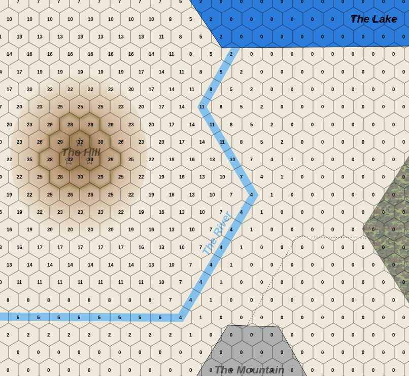

My game for testing various things. Most things in the
[hex-games](https://github.com/uablrek/hex-games) project was tested
first with this game. The map is simplistic and looks horrible.

Please read more on [github](
https://github.com/uablrek/hex-games/blob/main/the-hill-mp/README.md)

* **[Play as French against AI](the-hill.html?mode=ai&server=offline)**

The French player tries to occupy "The Hill", which means all 3
objective hexes (marked with stars), and the English player defends
them. The game takes 8 turns.

A snapshot is taken on every human (French) turn to [localStorage](
https://developer.mozilla.org/en-US/docs/Web/API/Window/localStorage)
in your browser. If a snapshot is found on load (or reload) you will
get a choice to use it.

The game has a *very* simple AI that:

* Can only play English
* Never attacks
* Tries to keep the objective hexes occupied

This is my first try with an [influence map](
https://www.google.com/search?q=games+influence+map):

The "AI" simply moves units to a hex with higher weight.
